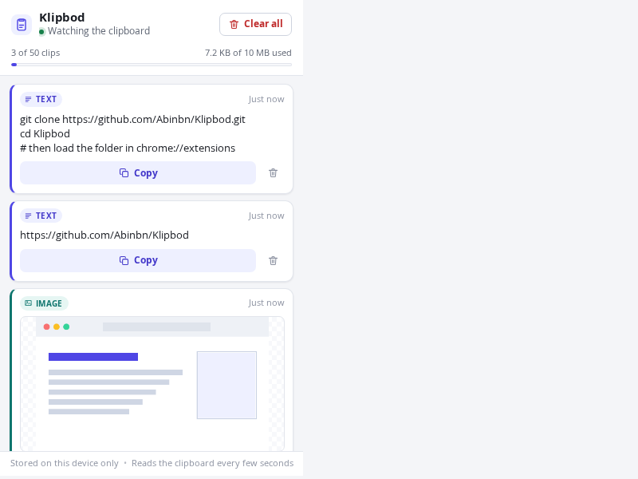
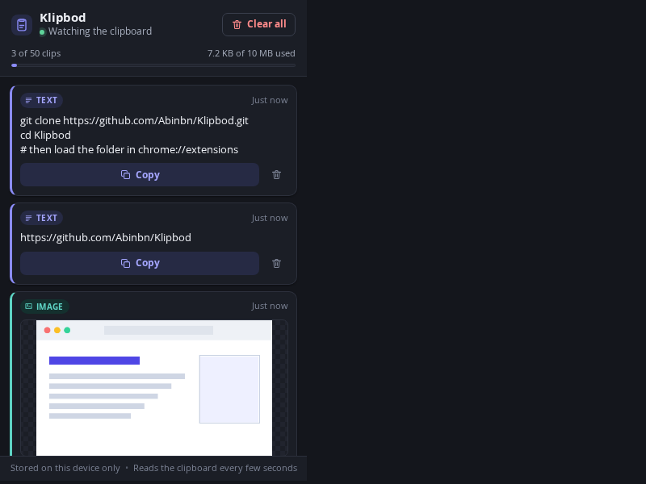

# Klipbod

Klipbod is the ultimate, lightweight clipboard manager built right into your browser.
Instead of cluttering your device’s local screenshot folders or relying on restrictive, built-in operating system clipboards, Klipbod gives you a unified, visual space to view, organize, and manage your copied text, code snippets, and images instantly.

### Why choose Klipbod?

- 📋 **All-in-One History:** View all your recently copied text, links, and screenshots in one beautiful dashboard.
- 🔒 **100% Private & Local-Only:** Nothing ever leaves your device. Your data is yours alone—no tracking, no cloud servers, no data collection.
- ⚡ **Ultra-Lightweight:** Designed to be fast and seamless without slowing down your browsing experience.
- 📂 **OS Alternative:** A clean, browser-centric substitute for Windows, macOS, or Linux built-in clipboards.
- 🆓 **Free & Open Source:** Licensed under the permissive MIT license. Totally free to use, modify, and contribute to.

Simplify your workflow and take control of your clipboard history with Klipbod.

| Light | Dark |
| --- | --- |
|  |  |

---

## Install

Klipbod has no build step: the folder you cloned *is* the extension.

1. Open `chrome://extensions` in Chrome (or any Chromium-based browser with Manifest V3 support, version 116 or newer).
2. Turn on **Developer mode** (top right).
3. Click **Load unpacked** and select this folder (the one containing `manifest.json`).
4. Pin Klipbod to the toolbar and start copying — text and screenshots show up in the popup.

Chrome will ask for permission to read data you copy and paste. That is the
`clipboardRead` permission, and it is the only permission that shows a warning.

## Using it

- **Copy anything.** Text, links, code, and screenshots are captured automatically and listed newest first.
- **Copy** puts a clip back on the clipboard. Text is written as text; images are written as PNG so you can paste them into chat, docs or image editors.
- **Delete** (trash icon) removes a single clip.
- **Clear all** asks for confirmation, then empties the whole history. The clip that is currently on the clipboard is not re-captured afterwards.
- The header shows how many clips are stored (out of 50) and how much of the storage quota is used.

## How it works

Chrome extensions cannot watch the clipboard from the background. A Manifest V3
service worker has no DOM and `navigator.clipboard` needs a focused document, so
Klipbod is split into three parts:

| File | Context | Job |
| --- | --- | --- |
| `background.js` | Service worker | Owns the history: accepts clipboard updates, de-duplicates, enforces the limits, writes to `chrome.storage.local`, keeps the reader alive. |
| `offscreen.js` | Offscreen document (`offscreen.html`) | Polls the clipboard with `document.execCommand('paste')` — the only way to read it without focus — and reports changes to the worker. |
| `popup.js` | Toolbar popup (`popup.html`) | Renders the history, re-copies clips, deletes clips, clears everything. |

`shared.js` holds the constants, the storage schema and the helpers used by all
three.

1. The worker creates the offscreen document (`chrome.offscreen`, reason `CLIPBOARD`) on startup and whenever the popup opens, and a one-minute `chrome.alarms` watchdog restarts it if it ever disappears.
2. The reader looks at the clipboard roughly once a second, backing off to once every five seconds when reading is expensive. It hashes what it finds and only talks to the worker when the content changed.
3. Text is identified by a SHA-256 of the text with newlines normalised. Images are identified by a SHA-256 of their decoded pixels, because Chrome re-encodes an image every time it is written to the clipboard — the bytes change, the picture does not.
4. The worker ignores content identical to the last thing it saw (so a clip you delete stays deleted while it is still on the clipboard), moves repeats back to the top instead of storing them twice, and saves anything new.

## Limits and data

- **50 clips** maximum; the oldest is dropped first.
- **10 MB** of storage (`chrome.storage.local` quota). When a new clip does not fit, the oldest images are evicted first, then the oldest clips, and the write is retried.
- Text up to **500,000 characters** is kept; longer text is skipped and the popup explains why.
- Images are stored as PNG data URLs up to **3 MB** each. Bigger screenshots are scaled down (and the card says so), so a 4K screenshot still ends up in your history.
- Everything lives in `chrome.storage.local`. Removing the extension removes the history with it; **Clear all** empties it at any time.

## Privacy

Klipbod is local-only: no network requests, no analytics, no accounts. See
[PRIVACY.md](PRIVACY.md) for the details, including the one thing worth knowing
before you install it: while Chrome is running, Klipbod polls the system
clipboard, so copies made in other applications (and in incognito windows) are
captured as well.

## Project layout

```
manifest.json      Manifest V3 definition, permissions and CSP
background.js      Service worker: history storage, limits, messaging, keeps the reader alive
offscreen.html     Offscreen document host (never displayed)
offscreen.js       Clipboard polling and image processing
shared.js          Constants, storage schema, shared helpers
popup.html         Toolbar popup markup
popup.css          Popup styles (light and dark via prefers-color-scheme)
popup.js           Popup logic: render, copy, delete, clear all
icons/             Extension icons (16, 32, 48, 128 px) generated from icon.svg
```

## Development

There is nothing to build and no dependencies to install. After editing a file,
go to `chrome://extensions` and click the reload icon on the Klipbod card, then
close and reopen the popup.

Things worth checking after a change:

- Copy text in another tab → it appears in the popup within a couple of seconds.
- Take a screenshot (`Ctrl`/`Cmd` + `Shift` + `S` on some systems) → an Image card appears.
- Copy the same text twice → it is not duplicated.
- **Copy** on a clip, then paste somewhere → the clip is back on the clipboard.
- **Clear all** → history is empty and the clipboard content does not reappear.
- Switch your OS between light and dark mode → the popup follows.

## License

[MIT](LICENSE) © 2026 Abin B N
